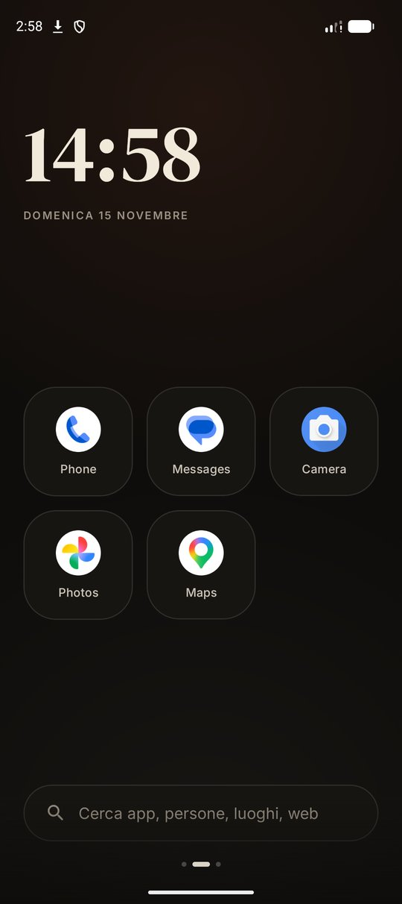
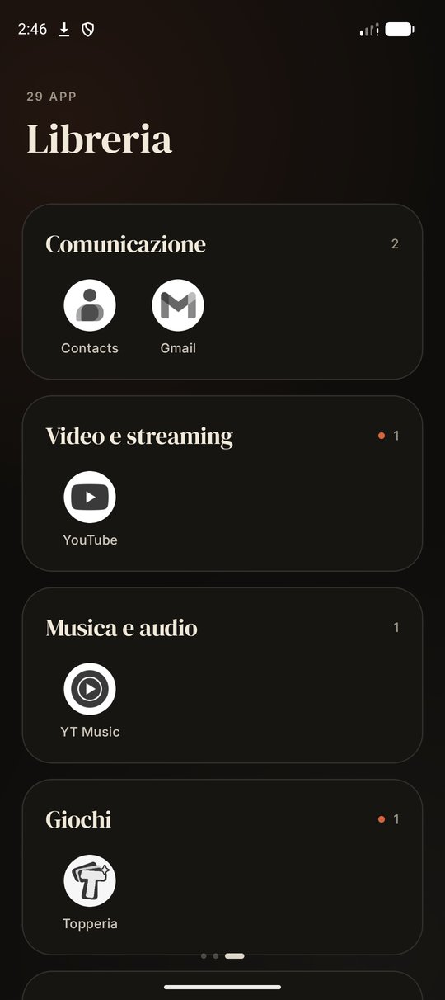
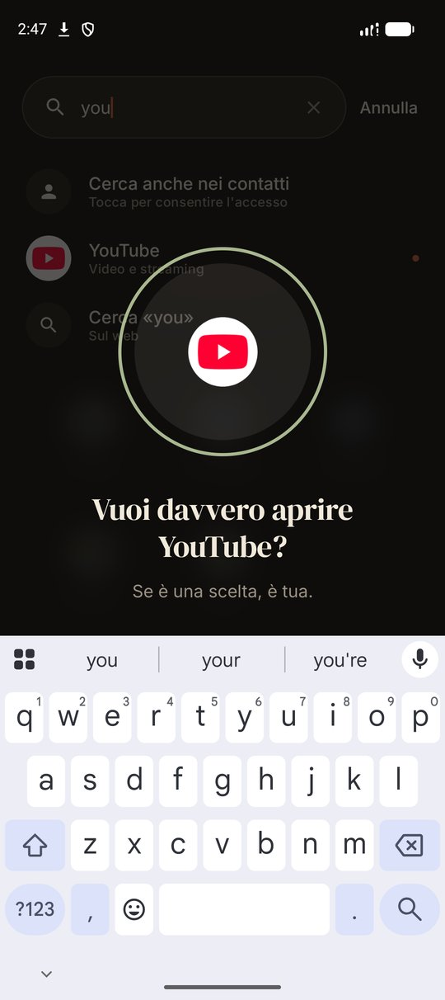

<p align="center"></p>

<h1 align="center">Kanso</h1>

Launcher Android open source che mette insieme semplicità e benessere digitale.
*Kanso* (簡素) è il principio estetico giapponese della semplicità: togliere il superfluo.

<p align="center">
  
  
  
  
  
</p>

## Tre schermate, nessun App Drawer

| Sinistra | Centro | Destra |
|---|---|---|
| **Consapevolezza**: agenda dei prossimi 7 giorni, tempo schermo e sblocchi di oggi, grafico per ora, app più usate, e i widget di Android che scegli tu | **Home**: orologio facoltativo (spento di default), poi solo una griglia di riquadri tutti uguali (Telefono, Messaggi, Fotocamera, Galleria, Mappe di default) e la barra di ricerca | **Libreria**: tutte le altre app raggruppate per categoria in automatico |

- **Ricerca universale**: app, contatti, indirizzi (aperti in Google Maps), siti e ricerca web. Il risultato evidenziato si apre con Invio.
- **Pulsanti rapidi** in alto nella Home: torcia e suoneria/vibrazione (senza toccare il Non disturbare), ognuno nascondibile dalle impostazioni.
- **App di lavoro**: in orario di lavoro la Home mostra il controllo Personale | Lavoro. Orario fisso (giorni e ore) oppure turni impostati settimana per settimana, anche di notte. Dalla Home si prendono ferie o un permesso, e il controllo sparisce finché dura. In orario le app di lavoro si aprono senza attrito.
- **Attrito consapevole**: prima di aprire un'app fuori dalla Home compare "Vuoi davvero aprire…?" con un respiro guidato. Social, video, giochi e shopping aspettano la durata intera, le altre app la metà.
- **Blocco**: impostazioni e modifica della Home protette da PIN (salvato come hash SHA-256 con sale) o dal gesto "tieni premuto 3 secondi".
- **Doppio tocco per bloccare** (facoltativo, dalle impostazioni): tocca due volte la Home per spegnere lo schermo. Usa un servizio di accessibilità che non legge nulla.
- **Spazio privato** (Android 15): con Kanso come Home, in fondo alla Libreria compare una sezione apposita con le sue app quando è sbloccato.
- **Riassunto notifiche** con uno swipe verso il basso in Home, con Cloudflare Workers AI e la tua chiave personale. Kanso tiene solo una copia locale delle notifiche ancora nel pannello (al massimo 24 ore): quelle che togli escono anche dal riassunto. Invia il testo solo quando premi "Riassumi". Le notifiche restano gestite da Android.

## Permessi

- Accesso ai dati di utilizzo: tempo schermo e sblocchi (resta sul telefono).
- Lettura notifiche: solo per il riassunto.
- Contatti: solo per la ricerca.
- Calendario (sola lettura): solo per l'agenda.
- Internet: solo per il riassunto AI.

## Riassunto AI

Nelle impostazioni inserisci l'**Account ID** di Cloudflare e un **token API** con permesso *Workers AI*
(dash.cloudflare.com → My Profile → API Tokens). Modello usato: `@cf/meta/llama-3.3-70b-instruct-fp8-fast`.

## Installazione

Scarica `Kanso-vX.Y.Z.apk` dall'[ultima release](https://github.com/carellice/kanso/releases/latest), installalo e scegli Kanso come app Home (Impostazioni di Kanso → Kanso come Home). Android 9 o successivo.

## Build

```bash
./gradlew assembleDebug
```

Kotlin + Jetpack Compose, minSdk 28. Nessuna dipendenza oltre AndroidX.

## Licenza

MIT
